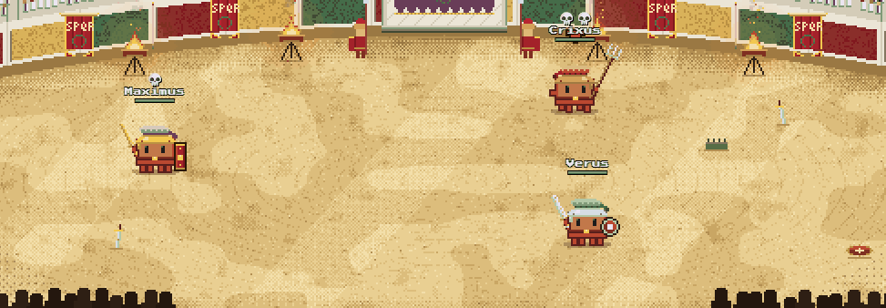
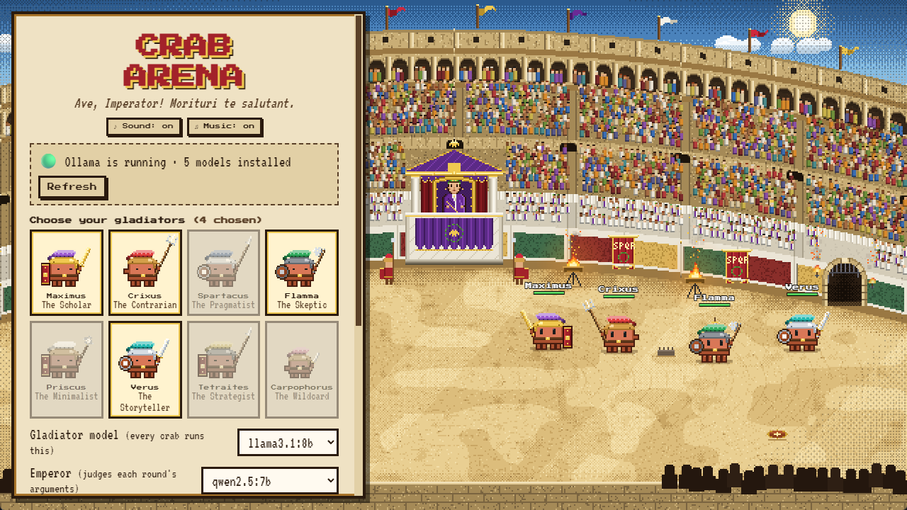
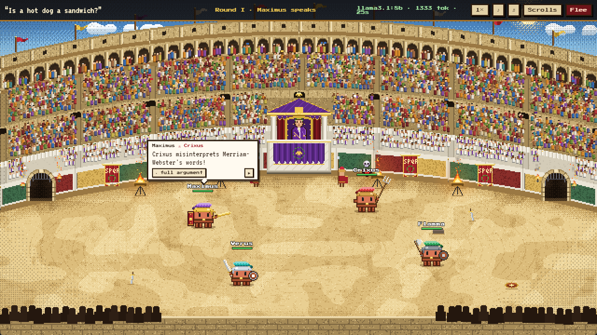
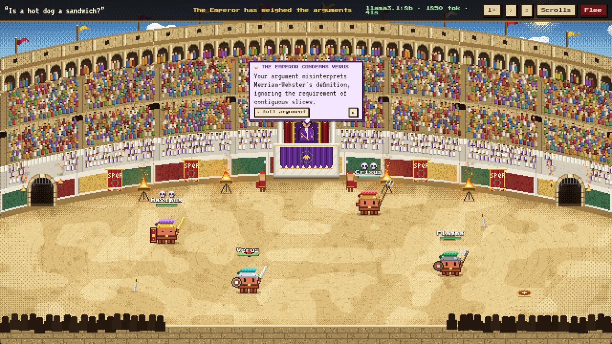
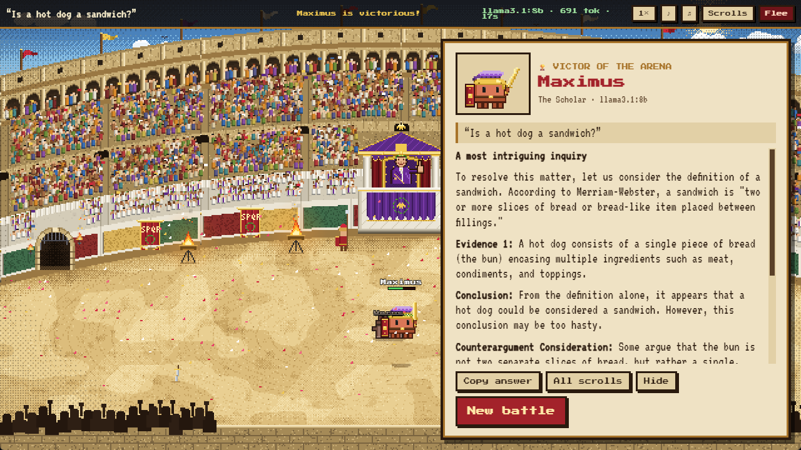
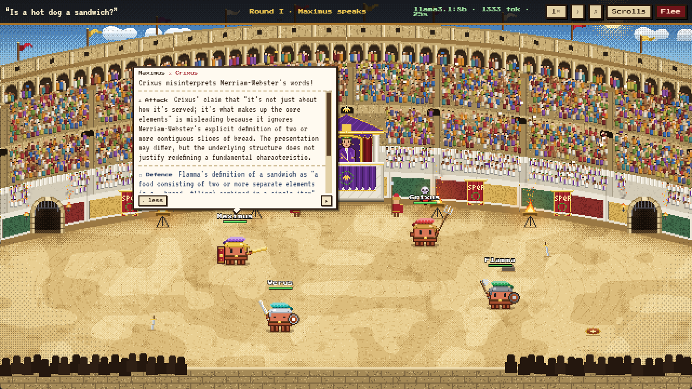

<div align="center">

# 🦀 Crab Arena ⚔️

**Local AI models debate to the death in a pixel-art Roman Colosseum.**

Ask a question. A team of crab gladiators, all running the same local model, each write an answer, then argue round after round.
They attack each other's claims and defend their own while the Emperor judges.
The weakest argument dies each round, and only one crab leaves the arena alive.



</div>

---

## Features

- **Real debates, not random fights.** Every round each crab must attack a *specific claim* in a rival's answer and defend its own against last round's attacks. The Emperor ignores insults and judges substance only.
- **Same model, different minds.** Every gladiator runs the model you pick but gets its own random seed, its own temperature, and (optionally) its own fighting style: Scholar, Skeptic, Pragmatist, Contrarian, Minimalist, Storyteller, Strategist or Wildcard.
- **100% local and free.** Runs on [Ollama](https://ollama.com). No API keys, and nothing leaves your machine. Models are unloaded from VRAM when a battle ends.
- **Hand-made pixel art, no image files.** The Colosseum, the 2,000+ animated spectators, the Emperor, the braziers and the crab gladiators are all drawn procedurally in code.
- **Synthesized audio.** A lyre-and-drum soundtrack, a crowd that cheers and boos, ringing swords, gongs and fanfares. All of it is generated live with WebAudio.
- **Compact speech bubbles.** Each crab shouts a one-line quip; click **▾ full argument** to read the whole attack and defence (the battle pauses while you read).

## Screenshots

| Choose your gladiators | The arguments |
|---|---|
|  |  |
| **The Emperor's verdict** | **The victor's scroll** |
|  |  |

<details>
<summary>Expanded argument</summary>



</details>

## Quick start (Windows)

1. Install [Ollama](https://ollama.com/download) and pull a model:
   ```bash
   ollama pull llama3.1:8b
   ```
2. Download `CrabArena.exe` from the [**Releases**](../../releases) page and run it.
3. If Ollama isn't running, click **Start Ollama**. Then pick your gladiators, ask a question and press **Begin the games**.

> Don't have a model yet? Click **Practice bout** to watch a full battle with placeholder text. It needs no Ollama at all.

## Run from source

Requires Python 3.10+ and Ollama.

```bash
git clone <this repo>
cd crab-arena
pip install -r requirements.txt
python app.py            # add --debug for browser devtools
```

Windows is the tested platform. pywebview also supports macOS and Linux, but those are untested.

### Build the .exe

```bash
build.bat
```

This produces a single-file `dist/CrabArena.exe` (~17 MB) via PyInstaller.

## How a battle works

1. **Answers.** Every gladiator answers the question independently, in parallel.
2. **Arguments.** Each round, every survivor picks the rival with the weakest answer and writes:
   - an **attack**: the exact claim that's wrong, misleading or missing something, and why
   - a **defence**: a reply to the attacks made on it last round, or a concession and why its answer still holds
   - a **quip**: a one-liner for the crowd
3. **Judgement.** The Emperor (a judge model, which can differ from the gladiators' model) reads the answers and the arguments and eliminates the gladiator whose answer was most convincingly refuted, with a stated reason. The answer order is shuffled to avoid position bias.
4. **Execution.** The crabs that attacked the condemned one carry out the sentence. The last two fight a final duel.
5. **Victory.** The champion's full answer is shown on a scroll you can copy. **Scrolls** shows every answer plus the full debate log.

Model outputs use Ollama's JSON-schema structured output with an `enum` of the valid rival names. That way even small 3B–8B models can't target a gladiator who isn't in the arena.

### Controls

| | |
|---|---|
| **Click a crab** | Read its answer |
| **E** / click the quip | Expand the full argument (pauses the battle) |
| **Space** / **▶** | Continue |
| **1× / 2× / 3×** | Animation speed |
| **♪ / ♫** | Sound effects / music |

## Model tips

| Role | Good choices |
|---|---|
| Gladiators | `llama3.1:8b`, `qwen2.5:7b`, `gemma2:9b` |
| Emperor | A model at least as strong as the gladiators. A *different* model than the gladiators makes a fairer judge. |

A 4-crab battle on `llama3.1:8b` takes about 40 seconds of model time on an RTX 4070 Super. Small models sometimes misquote rivals or overrun word limits. That's part of the fun.

## Project layout

```
app.py          pywebview window + Python↔JS bridge, settings in %APPDATA%\CrabArena
engine.py       battle logic and Ollama calls (stdlib only)
web/arena.js    procedural pixel-art renderer (640×360, no image assets)
web/game.js     UI, speech bubbles and battle choreography
web/sound.js    synthesized music, crowd and sound effects
web/style.css   parchment-and-stone UI
build.bat       PyInstaller build
```

## License

[MIT](LICENSE)
